# Paint.NET Plugin Interface & Class Architecture

This document describes the design, class hierarchy, execution context, and local state management for the Gemini Banana Bridge suite of plugins.

---

## 1. Class Hierarchy & Split Architecture

To provide specialized tools, the project compiles into seven distinct Paint.NET Effects.

```mermaid
classDiagram
    class AiStyleEffect {
        +AiStyleToken Token
        +CreateConfigDialog() AiStylePaintNetDialog
        #OnRender() void
    }
    class AiEditEffect {
        +AiEditToken Token
        +CreateConfigDialog() AiEditPaintNetDialog
        #OnRender() void
    }
    class AiAddFrameEffect {
        +AiAddFrameToken Token
        +CreateConfigDialog() AiAddFramePaintNetDialog
        #OnRender() void
    }
    class AiAssetCreatorEffect {
        +AiAssetCreatorToken Token
        +CreateConfigDialog() AiAssetCreatorPaintNetDialog
        #OnRender() void
    }
    class AiImageCreatorEffect {
        +AiImageCreatorToken Token
        +CreateConfigDialog() AiImageCreatorPaintNetDialog
        #OnRender() void
    }
    class AiIsolatorEffect {
        +AiIsolatorToken Token
        +CreateConfigDialog() AiIsolatorPaintNetDialog
        #OnRender() void
    }
    class BananaEffect {
        +BananaToken Token
        +CreateConfigDialog() BananaPaintNetDialog
        #OnRender() void
    }
    
    class AiStyleDialog {
        -ComboBox cbCategory
        -ComboBox cbStyles
        -TrackBar tbStrength
        -Button btnGenerate
        -PictureBox pbPreview
    }
    
    class AiEditDialog {
        -InteractiveCanvas canvas
        -TextBox txtChatHistory
        -TextBox txtPrompt
        -Button btnGenerate
    }

    class InteractiveCanvas {
        +Bitmap SourceImage
        +Bitmap MaskImage
        +bool IsBrushMode
        +int BrushSize
        +ZoomFit() void
        #OnPaint() void
        #OnMouseDown() void
        #OnMouseMove() void
        #OnMouseWheel() void
    }

    class AiAddFrameDialog {
        -ComboBox cbStyles
        -TrackBar tbWeight
        -CheckBox chkTransparentCenter
        -TextBox txtPromptAddition
        -Button btnGenerate
    }

    class AiAssetCreatorDialog {
        -TabControl tabControl
        -ComboBox cbSpecies
        -ComboBox cbFashion
        -ComboBox cbLocationType
        -Button btnSavePreset
        -Button btnLoadPreset
    }

    class AiImageCreatorDialog {
        -ComboBox cbStyleCategory
        -ComboBox cbCompositionLayout
        -TextBox txtPrompt
        -Button btnGenerate
    }

    class AiIsolatorDialog {
        -TextBox txtPrompt
        -CheckBox chkDrawOutline
        -Button btnOutlineColor
        -TrackBar tbOutlineWidth
    }

    class BananaDialog {
        -TextBox txtChatHistory
        -ComboBox cbStyles
        -Button btnGenerate
    }
```

---

## 2. Core Effects & Tokens

Each plugin is mapped to a specific token that manages its configuration state and preserves undo/redo data in Paint.NET:

### 2.1 AI Style Applier
* **Effect Class:** `AiStyleEffect` (registered as `"AI Style Applier"` under submenu `"AI Tools"`)
* **Token Class:** `AiStyleToken`
  * `string SelectionHash`: Detects selection changes to clear previous result/history when the user selects a new region.
  * `int[] PixelColors`: Safe flat 1D ARGB array representing the restyled image pixels.
  * `string SelectedCategory`: The chosen preset category name.
  * `string SelectedStyleId`: The specific style ID.
  * `int StyleStrength`: The slider percentage determining style prompt injection.

### 2.2 AI Image Editor
* **Effect Class:** `AiEditEffect` (registered as `"AI Image Editor"` under submenu `"AI Tools"`)
* **Token Class:** `AiEditToken`
  * `List<ChatTurn> ChatHistory`: Maintains conversational memory for iterative multi-turn editing.
  * `int[] MaskPixelColors`: Holds custom mask layers painted by the user inside the editor.
  * `InteractiveCanvas`: A custom Windows Forms control that wraps zooming, panning, and brush/eraser masking. It maps UI-space drawing coordinates to the underlying `MaskImage` bitmap.

### 2.3 AI Add Frame
* **Effect Class:** `AiAddFrameEffect` (registered as `"AI Add Frame"` under submenu `"AI Tools"`)
* **Token Class:** `AiAddFrameToken`
  * `int FrameWeight`: Border thickness percentage (2% to 30%).
  * `bool TransparentCenter`: If true, the `OnRender` loop writes alpha = 0 (transparent) to all pixels inside the center boundary, making it perfect for transparent frame overlays on separate layers.

### 2.4 AI Asset Creator
* **Effect Class:** `AiAssetCreatorEffect` (registered as `"AI Asset Creator"` under submenu `"AI Tools"`)
* **Token Class:** `AiAssetCreatorToken`
  * `string SelectedTab`: Active asset mode (`Character`, `Location`, or `Prop`).
  * `string SpeciesName`, `GenderName`, `PersonalityName`, `FashionName`, `AccessoryName`, `PaletteName`, `PoseName`: Granular character building blocks.
  * `string LocationTypeName`, `StructureName`, `VisualStateName`, `AtmosphereName`: Environment generation attributes.
  * `string PropName`, `MaterialName`, `ConditionName`: Standalone object descriptors.
  * `Preset Serialization`: JSON import/export for saving and reusing complex character sheets and environment designs.

### 2.5 AI Image Creator
* **Effect Class:** `AiImageCreatorEffect` (registered as `"AI Image Creator"` under submenu `"AI Tools"`)
* **Token Class:** `AiImageCreatorToken`
  * `string CompositionLayoutName`: Injects classical compositional armatures (Rule of Thirds, Triangular Composition, Central Symmetry) to control focal flow and framing.
  * `string StyleCategory` & `string StyleName`: Optional visual restyling guides.
  * `bool ScaleToFit` & `bool CopyToClipboard`: Controls destination surface placement and clipboard export.

### 2.6 AI Outline Selector & Isolator
* **Effect Class:** `AiIsolatorEffect` (registered as `"AI Outline Selector & Isolator"` under submenu `"AI Tools"`)
* **Token Class:** `AiIsolatorToken`
  * `bool DrawOutline`: When enabled, renders a crisp boundary stroke around the alpha silhouette of the isolated subject.
  * `int OutlineColor`: 32-bit ARGB color value for the contour stroke.
  * `int OutlineWidth`: Width of the boundary outline (1px to 10px).
  * `string Prompt`: Segmenting instructions (e.g., "Isolate character and remove all background elements").

### 2.7 Banana AI Editor
* **Effect Class:** `BananaEffect` (registered as `"Banana AI Editor"` under submenu `"AI Tools"`)
* **Token Class:** `BananaToken`
  * `List<ChatTurn> ChatHistory`: Tracks conversational chat turn history for iterative edits.
  * `string AppliedStyles`: Selected style preset name.
  * `bool GenerateFromScratch`: Direct generation without source canvas conditioning.

---

## 3. Safe GDI+ Threading Model

Paint.NET invokes `OnRender` concurrently across multiple CPU threads. Since GDI+ `System.Drawing.Bitmap` methods (like `Width`, `Height`, and `GetPixel`) are fundamentally thread-unsafe, any shared bitmap state will cause random crashes (`Object is currently in use elsewhere`).

To ensure total thread safety:
1. Dialogs copy generated GDI+ bitmaps into flat C# `int[] PixelColors` arrays upon closure (using `LockBits` and row-by-row `Marshal.Copy` aligned to the bitmap `Stride`).
2. The tokens store only these raw `int[]` arrays.
3. The parallel `OnRender` threads read from these thread-safe array fields directly using local coordinate math:
   `int argb = pixels[cropY * imageWidth + cropX];`
   `DstArgs.Surface[x, y] = ColorBgra.FromUInt32((uint)argb);`

